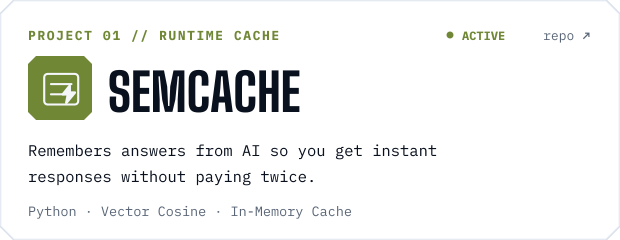
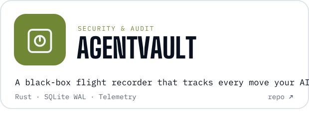
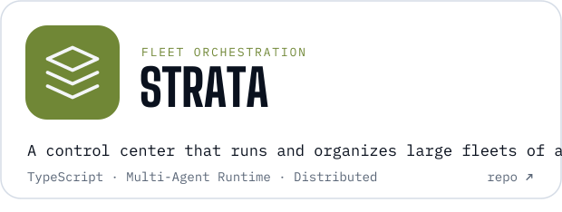
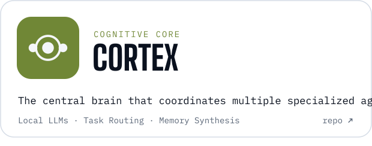

<div align="center">
  <a href="https://github.com/sshloktiwarii">
    <picture>
      <source media="(prefers-color-scheme: dark)" srcset="assets/bento-dark.svg">
      
    </picture>
  </a>
</div>

<br>

<div align="center">
  <picture>
    <source media="(prefers-color-scheme: dark)" srcset="assets/activity-dark.svg">
    
  </picture>
</div>

<br>

## Systems & Flagship Projects

<p align="center">
  <a href="https://github.com/sshloktiwarii/semcache"><picture><source media="(prefers-color-scheme: dark)" srcset="assets/project-semcache-dark.svg"></picture></a>
  <a href="https://github.com/sshloktiwarii/agentvault"><picture><source media="(prefers-color-scheme: dark)" srcset="assets/project-agentvault-dark.svg"></picture></a>
</p>
<p align="center">
  <a href="https://github.com/sshloktiwarii/strata"><picture><source media="(prefers-color-scheme: dark)" srcset="assets/project-strata-dark.svg"></picture></a>
  <a href="https://github.com/sshloktiwarii/cortex"><picture><source media="(prefers-color-scheme: dark)" srcset="assets/project-cortex-dark.svg"></picture></a>
</p>

<br>

## Transmit / Say Hello

```sh
$ ssh sshloktiwarii@terminal.local -p 2200
> STATUS: ONLINE [LOW-LATENCY RUNTIME]
> SPECIALIZATION: SYSTEMS & AUTONOMOUS AI INFRASTRUCTURE
```

- **Email:** [sshloktiwarii@gmail.com](mailto:sshloktiwarii@gmail.com)
- **GitHub:** [@sshloktiwarii](https://github.com/sshloktiwarii)
- **LinkedIn:** [linkedin.com/in/sshloktiwarii](https://linkedin.com/in/sshloktiwarii)

<br>

<div align="center">
  <picture>
    <source media="(prefers-color-scheme: dark)" srcset="assets/footer-dark.svg">
    
  </picture>
</div>
